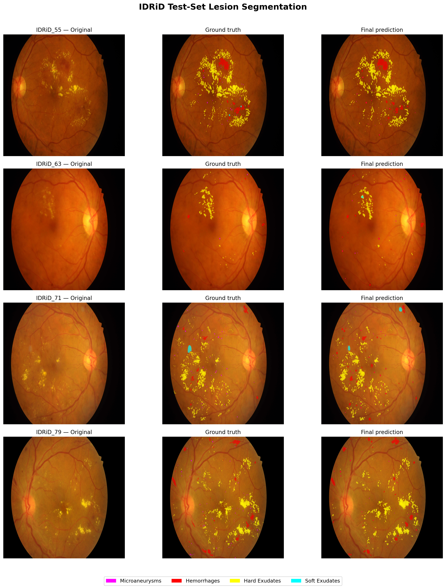
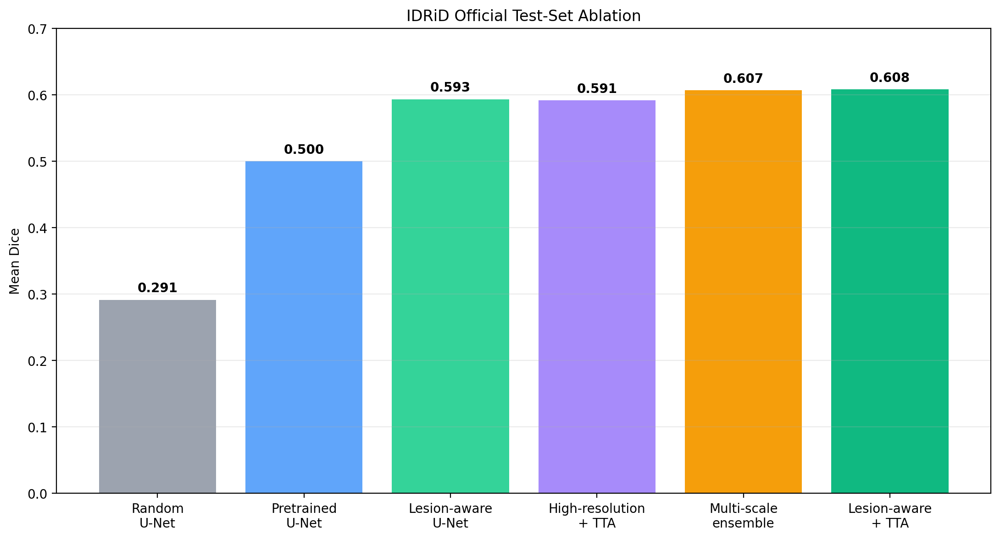

# Diabetic Retinopathy Lesion Segmentation

A PyTorch project for segmenting four diabetic-retinopathy lesions in retinal fundus images:

- Microaneurysms
- Hemorrhages
- Hard exudates
- Soft exudates

I built this project to explore how much a standard U-Net could be improved on a small and highly imbalanced medical-imaging dataset. I started with a randomly initialized baseline, then tested ImageNet pretraining, a lesion-aware loss, higher-resolution fine-tuning, test-time augmentation, and lesion-specific model fusion.

The final validation-selected system reached a **mean Dice of 0.6066** on the official IDRiD test split.

## Qualitative results




*Images and annotations are from the [IDRiD dataset](https://idrid.grand-challenge.org/Data/), licensed under [CC BY 4.0](https://creativecommons.org/licenses/by/4.0/). Images were resized and overlaid with ground-truth masks and model predictions for this project.*

The visualization shows the input image, ground-truth annotations, and model predictions.
Mask colors: microaneurysms (magenta), hemorrhages (red), hard exudates (yellow), and soft exudates (cyan).

## Results

All test results use thresholds selected on the validation set. The official test set was not used for threshold tuning or model selection.

### Final system

| Lesion | Threshold | Dice | IoU | Precision | Recall | AUPR |
|---|---:|---:|---:|---:|---:|---:|
| Microaneurysms | 0.38 | 0.4463 | 0.2872 | 0.4191 | 0.4772 | 0.3983 |
| Hemorrhages | 0.48 | 0.6180 | 0.4472 | 0.6280 | 0.6083 | 0.6279 |
| Hard exudates | 0.90 | 0.7128 | 0.5537 | 0.7426 | 0.6853 | 0.7941 |
| Soft exudates | 0.32 | 0.6494 | 0.4808 | 0.7221 | 0.5900 | 0.6354 |
| **Mean** | — | **0.6066** | **0.4422** | — | — | **0.6139** |

The weakest class remains microaneurysms. They occupy very few pixels and are easily lost during resizing, which makes them particularly difficult to segment.

### Experiment progression

| Experiment | Mean test Dice | Mean test IoU |
|---|---:|---:|
| Randomly initialized U-Net | 0.2912 | 0.1874 |
| ImageNet-pretrained U-Net | 0.4995 | 0.3483 |
| High-resolution model with TTA | 0.5912 | 0.4279 |
| Lesion-aware U-Net | 0.5930 | 0.4304 |
| **Final multiscale system** | **0.6066** | **0.4422** |
| Lesion-aware U-Net with TTA | 0.6080 | 0.4455 |



The lesion-aware model with test-time augmentation obtained a test Dice of 0.6080, which is 0.0014 higher than the final multiscale system. However, the multiscale system was selected using validation results before evaluating the test set, so I kept it as the final system instead of retrospectively selecting the best test result.

## Dataset

This project uses the lesion-segmentation subset of the [Indian Diabetic Retinopathy Image Dataset (IDRiD)](https://idrid.grand-challenge.org/Data/).

The segmentation data contains:

- 54 annotated training images
- 27 annotated test images
- A separate binary mask for each lesion type

I divided the 54 official training images into:

- 43 training images
- 11 validation images

The 27 official test images were kept separate until the final evaluation.

The dataset itself is not included in this repository. After downloading it, place it under:

```text
data/raw/A. Segmentation/
├── 1. Original Images/
│   ├── a. Training Set/
│   └── b. Testing Set/
└── 2. All Segmentation Groundtruths/
    ├── a. Training Set/
    │   ├── 1. Microaneurysms/
    │   ├── 2. Haemorrhages/
    │   ├── 3. Hard Exudates/
    │   └── 4. Soft Exudates/
    └── b. Testing Set/
        ├── 1. Microaneurysms/
        ├── 2. Haemorrhages/
        ├── 3. Hard Exudates/
        └── 4. Soft Exudates/
```

## Approach

I developed the model in several stages:

1. A four-channel U-Net with a ResNet-34 encoder and random initialization.
2. ImageNet encoder pretraining.
3. A lesion-aware loss combining focal BCE and class-weighted focal Tversky loss.
4. Fine-tuning at 1024 × 1024 to preserve smaller lesions.
5. Horizontal-flip test-time augmentation.
6. Lesion-specific fusion of the strongest validation models.

Each output channel represents one lesion class and uses an independent sigmoid activation.

### Final multiscale system

The final system combines models separately for each lesion:

| Lesion | Models | Fusion | Threshold |
|---|---|---|---:|
| Microaneurysms | Lesion-aware 1024 + lesion-aware 768 | Average | 0.38 |
| Hemorrhages | Lesion-aware 1024 + pretrained baseline 768 | Average | 0.48 |
| Hard exudates | Pretrained baseline 768 | Single model | 0.90 |
| Soft exudates | Lesion-aware 1024 + lesion-aware 768 | Average | 0.32 |

Predictions from the 768 × 768 models are resized to 1024 × 1024 before fusion.

## Repository structure

```text
├── src/                 # Dataset, models, losses, training and evaluation
├── notebooks/           # Data exploration
├── data/splits/         # Training, validation and test metadata
├── assets/results/      # Figures used in this README
├── results/             # Saved metrics and experiment summaries
├── requirements.txt
└── README.md
```

## Setup

The project was tested with Python 3.12.

```bash
git clone https://github.com/cestlvvie/diabetic-retinopathy-lesion-segmentation.git
cd diabetic-retinopathy-lesion-segmentation

python3.12 -m venv .venv
source .venv/bin/activate

pip install --upgrade pip
pip install -r requirements.txt
```

Training was performed using a free Kaggle Tesla T4 GPU.

## Training

The main lesion-aware model can be trained with:

```bash
python -m src.train \
  --dataset-root "data/raw/A. Segmentation" \
  --metadata-csv data/splits/idrid_training_metadata.csv \
  --output-dir outputs/lesion_aware_pretrained \
  --image-size 768 \
  --batch-size 2 \
  --epochs 40 \
  --learning-rate 1e-4 \
  --patience 8 \
  --pretrained \
  --loss lesion_aware
```

The random baseline uses the same training script with `--loss combined` and without `--pretrained`.

To see all available options:

```bash
python -m src.train --help
```

## Evaluation

Individual checkpoints can be evaluated using `src.evaluate`. The final multiscale system uses three checkpoints:

```text
checkpoints/
├── lesion_aware_1024.pt
├── lesion_aware_768.pt
└── pretrained_baseline_768.pt
```

Run the final evaluation with:

```bash
python -m src.evaluate_ensemble \
  --dataset-root "data/raw/A. Segmentation" \
  --metadata-csv data/splits/idrid_test_metadata.csv \
  --checkpoint-dir checkpoints \
  --output-dir outputs/final_evaluation \
  --split test
```

To see the arguments for evaluating a single checkpoint:

```bash
python -m src.evaluate --help
```


The checkpoints and dataset are intentionally excluded from Git because of their size.

## Limitations

- IDRiD contains relatively few pixel-level annotated images.
- Results are based on one training/validation split rather than cross-validation.
- Images were resized to square inputs, changing their original aspect ratio.

## Possible next steps

- Patch-based or aspect-ratio-preserving training for small lesions
- Cross-validation of the lesion-aware model
- Adding diabetic-retinopathy severity grading

## References and attribution

This project uses the [IDRiD dataset](https://idrid.grand-challenge.org/Data/), which is licensed under [CC BY 4.0](https://creativecommons.org/licenses/by/4.0/).

- Porwal et al. [Indian Diabetic Retinopathy Image Dataset (IDRiD)](https://doi.org/10.21227/H25W98). IEEE DataPort, 2018.
- Porwal et al. [Indian Diabetic Retinopathy Image Dataset (IDRiD): A Database for Diabetic Retinopathy Screening Research](https://doi.org/10.3390/data3030025). *Data*, 2018.
- Porwal et al. [IDRiD: Diabetic Retinopathy—Segmentation and Grading Challenge](https://doi.org/10.1016/j.media.2019.101561). *Medical Image Analysis*, 59, 101561, 2020.